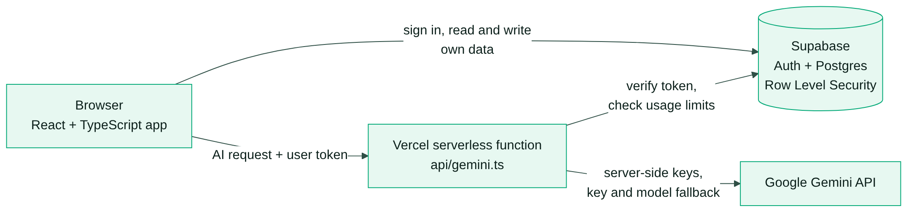

<p align="center">
  
</p>

<h1 align="center">FitTrack</h1>

<p align="center"><i>AI-powered, personalized workout and diet planning.</i></p>

<p align="center">
  <a href="https://fittrack.parthbhuptani.me"></a>
  <a href="https://react.dev"></a>
  <a href="https://tailwindcss.com"></a>
  <a href="https://ai.google.dev"></a>
  <a href="https://supabase.com"></a>
  <a href="https://vercel.com"></a>
</p>

> FitTrack generates a complete, personalized 7-day workout and diet plan from a single profile (age, weight, goal, activity level, dietary restrictions, injuries and available equipment), then helps you follow it day by day: tick off exercises and meals, track water and weight, and ask an AI coach follow-up questions.

**Live app:** [fittrack.parthbhuptani.me](https://fittrack.parthbhuptani.me)

FitTrack is free and open source.

---

## 📌 Table of Contents

- [About the Project](#-about-the-project)
- [Live Demo](#-live-demo)
- [Features](#-features)
- [Design](#-design)
- [Tech Stack](#️-tech-stack)
- [Project Structure](#-project-structure)
- [Architecture & Security](#-architecture--security)
- [Performance](#-performance)
- [Running Locally](#-running-locally)
- [Deployment](#️-deployment)
- [Roadmap](#️-roadmap)
- [Contributing](#-contributing)
- [License](#-license)

---

## 🧠 About the Project

**FitTrack** is a full-stack web app that turns one fitness profile into a complete, AI-generated weekly plan. There are no generic templates: it adapts to the person using it, including their injuries, allergies, equipment and goals.

Everything from the workout structure to the meal recipes is generated fresh for each user, and a chat-based AI coach is there for follow-up questions once the plan is live. Accounts, plans and progress are stored in a real database with proper authentication, not in the browser.

---

## 🌐 Live Demo

**[https://fittrack.parthbhuptani.me](https://fittrack.parthbhuptani.me)**

> Sign up (email or Google), fill out your profile, and watch a 7-day plan get generated. Then try the Today tab, the meal recipes and the AI coach.

---

## ✨ Features

| | Feature | Description |
|---|---|---|
| 🧬 | **Personalized 7-day plans** | A full week of workouts and meals tailored to age, weight, goal, activity level, diet type, allergies, injuries and equipment |
| 📅 | **Today view** | One screen for the day: workout, meals, water and your streak, with a week strip to jump between days |
| 🏋️ | **Workouts** | Tick exercises off as you go, with sets and reps, form tips, a built-in rest/workout timer and form videos |
| 🔄 | **Easier / harder swaps** | Every exercise has an easier and a harder variation. Swaps are saved to your plan |
| 🍳 | **Meals and recipes** | Every meal has calories, a real ingredient list and step-by-step instructions, plus a cooking-video link |
| 🩹 | **Injury-aware** | Workouts are generated with your stated injuries and conditions in mind |
| 🤖 | **AI coach** | In-app chat that knows your profile and your plan. Chat history is saved |
| 📊 | **Progress** | Week and month views of daily completion, weight and water, with hover details, plus a printable report |
| 💧 | **Water tracking** | Daily intake against a goal you set yourself in Settings |
| ⚙️ | **Settings** | Edit your profile and units (metric or imperial). Rebuild the plan when something important changes |
| 🌗 | **Light and dark themes** | Saved per account and follows you across devices |
| 👤 | **Real accounts** | Sign up and log in by email and password or Google, backed by Supabase Auth |
| 📱 | **Built for phones** | Bottom navigation on small screens, sidebar on desktop, tested down to 320px wide |

---

## 🎨 Design

The interface is deliberately plain: a calm light or dark canvas, one green accent, generous spacing and large readable type. It uses a small set of design tokens (CSS variables) for colour and surface, so both themes stay consistent.

- **Type:** Bricolage Grotesque for headings, Instrument Sans for body text, both self-hosted through Fontsource
- **Icons:** Lucide
- **Motion:** small and purposeful. It respects the system "reduce motion" setting everywhere except the loading logo, which needs to move to show that something is loading
- **Styles:** Tailwind CSS compiled at build time, plus scoped stylesheets for the landing page, sign-up flow and app screens

---

## 🛠️ Tech Stack

| Layer | Technology |
|---|---|
| Frontend | React 19, TypeScript, Vite |
| Styling | Tailwind CSS (build-time via PostCSS), CSS design tokens, Fontsource variable fonts |
| Charts | Plain CSS and SVG (no chart library) |
| Icons | Lucide React |
| AI | Google Gemini API, called only from a serverless function |
| Auth and database | Supabase (Postgres, Authentication, Row Level Security), Google OAuth |
| Hosting | Vercel (frontend and serverless functions) |
| Analytics | Vercel Web Analytics |

---

## 📁 Project Structure

```
fittrack/
├── api/
│   └── gemini.ts               # Serverless function: holds the Gemini API keys server-side, checks the
│                                # user's login, enforces per-user usage limits, validates the request,
│                                # handles plan generation and chat, with key and model fallback
│
├── components/
│   ├── LandingPage.tsx          # Home page (first paint, not lazy-loaded)
│   ├── AuthFlow.tsx             # Login / sign up / Google / profile setup / plan generation (lazy-loaded)
│   ├── Dashboard.tsx            # Logged-in app: state, data saving, tab routing (lazy-loaded)
│   ├── landing/                 # Landing page styles and content data
│   ├── auth/                    # Sign-up and login styles
│   ├── app/
│   │   ├── AppShell.tsx         # Top bar, sidebar, mobile bottom bar, profile menu
│   │   ├── TodayView.tsx        # Today tab
│   │   ├── WorkoutsView.tsx     # Workouts tab (checklist, swaps, timer)
│   │   ├── MealsView.tsx        # Meals tab (recipes, ticking meals)
│   │   ├── CoachView.tsx        # AI coach chat
│   │   ├── ProgressView.tsx     # Progress charts and stats
│   │   ├── SettingsView.tsx     # Profile, units, water goal, log out
│   │   ├── WeekStrip.tsx        # Week selector used by several tabs
│   │   └── *.css                # Scoped styles for the shell and the views
│   └── ui/                      # Toast, Dropdown, Sheet, Loader
│
├── services/
│   ├── geminiService.ts         # Frontend client: calls /api/gemini, never sees the real key
│   ├── supabaseClient.ts        # Supabase connection setup
│   └── storageService.ts        # Auth and database logic: accounts, profiles, plans, logs,
│                                # chat history, theme, Google sign-in
│
├── public/                      # Favicon, logo, OG image, robots.txt, sitemap.xml
├── App.tsx                      # Session check, routing, top-level state
├── utils.ts                     # Shared helpers (dates, units, water goal)
├── types.ts                     # Shared TypeScript types
├── index.css                    # Tailwind layers, design tokens, loader
├── index.html                   # Page shell, meta and link-preview tags
├── tailwind.config.js / postcss.config.js
└── vite.config.ts / tsconfig.json / package.json
```

---

## 🔒 Architecture & Security

**AI calls are never made directly from the browser.**

- A serverless function (`/api/gemini.ts`) holds the Gemini API keys server-side and handles plan generation and chat.
- The frontend calls this internal endpoint rather than Google's API, so keys never appear in the client bundle or in dev tools.
- **Login required:** the function checks the user's Supabase session before doing anything.
- **Per-user limits:** usage is counted in an `api_usage` table (currently 10 plan generations a day and 40 chat messages an hour per user). If the database can't be reached, the function refuses the request rather than allowing free calls.
- **Input checks:** request size, message length and profile shape are validated server-side.
- **Key and model fallback:** if a call fails (rate limit, quota, temporary outage), it retries on a backup key or model, invisibly to the user.

**Authentication and data are handled by Supabase.**

- Real authentication via Supabase Auth (email and password, and Google OAuth).
- Profiles, plans, progress logs and chat history live in Postgres and follow the account across devices.
- **Row Level Security** is enabled on every table, so a user can only read or write their own rows.
- First-time Google users have no profile yet, so the app detects this and sends them to profile setup before generating a plan.

**Safe rendering.** The coach's replies are rendered as plain text with simple formatting (line breaks, lists, bold), never as raw HTML.

**Dates.** Day boundaries use the user's local date, so a log made at 1 a.m. lands on the right day in any time zone.


---

## ⚡ Performance

- The app is **code-split**: the first download contains only the landing page. The sign-up flow and the dashboard load on demand with `React.lazy` and `Suspense`.
- Charts are drawn with CSS and SVG, with no chart library to download.
- Tailwind is compiled at build time, so there is no runtime styling script.
- Fonts are self-hosted and variable, so there are no requests to third-party font servers.
- A session-check guard stops the landing page flashing for returning, logged-in users.

---

## 🚀 Running Locally

**Prerequisites:** Node.js, a Supabase project, a Google OAuth client (for Google sign-in)

```bash
npm install
```

Create a `.env.local` file in the project root:

```
GEMINI_API_KEY=your_primary_key_here
GEMINI_API_KEY_2=your_backup_key_here
VITE_SUPABASE_URL=your_supabase_project_url
VITE_SUPABASE_ANON_KEY=your_supabase_anon_key
```

```bash
npm run dev
```

> AI plan generation and the AI coach depend on the serverless function in `/api`, which runs in a deployed environment (or locally with the Vercel CLI's `vercel dev`). With plain `npm run dev` you can work on the UI, auth and database flows; AI responses need a deployed instance or `vercel dev`.

---

## ☁️ Deployment

Deployed on [Vercel](https://vercel.com), connected to this repository's `main` branch. Every merge triggers an automatic redeploy. The production site is served at **fittrack.parthbhuptani.me**, and the old `*.vercel.app` addresses redirect to it with a permanent (308) redirect.

Required environment variables (Vercel project settings):
- `GEMINI_API_KEY`
- `GEMINI_API_KEY_2`
- `VITE_SUPABASE_URL`
- `VITE_SUPABASE_ANON_KEY`

The serverless function also needs access to the Supabase `api_usage` table for usage limits.

Auth setup: add the production and local addresses to Supabase (Authentication, URL Configuration) and to the Google OAuth client's authorised origins.

Work happens on feature branches and goes to `main` through pull requests, tested on Vercel's preview deployments first.

---

## 🗺️ Roadmap

**Done**
- [x] Responsive redesign with light and dark themes
- [x] Landing page and sign-up flow redesign
- [x] Today, Workouts, Meals, Coach, Progress and Settings screens
- [x] Per-user rate limiting and input validation on the AI endpoint
- [x] Charts without a chart library
- [x] Custom domain
- [x] Per-user daily water goal

**Next: trust and basics before wider sharing**
- [ ] Forgot-password flow and email confirmation on sign-up
- [ ] Delete my account (server function) and export my data
- [ ] Privacy policy and terms pages, linked from the footer
- [ ] Error tracking (Sentry) and basic automated tests
- [ ] Support or contact channel
- [ ] Accessibility and real-device testing pass
- [ ] Database review: indexes, backups, usage-table cleanup

**Then: growth features**
- [ ] Transactional emails (welcome, weekly summary) through a sender such as Resend
- [ ] Payments and plans: free and paid tiers, with limits per tier
- [ ] Photo-based meal logging: upload a food photo and Gemini estimates calories
- [ ] Longer plan durations (beyond the fixed 7 days) and plan history
- [ ] Real charts in the printed report
- [ ] More goals (endurance, flexibility)
- [ ] Reminders and an installable app (PWA)

**Later**
- [ ] Testimonials and social proof, once there are real users
- [ ] Usage analytics events (sign-ups, drop-off points)
- [ ] More languages

---

## 🤝 Contributing

Ideas and pull requests are welcome. Open an issue first for anything large. Please keep changes small and focused, and check on a phone-width screen as well as desktop.

---

## 📄 License

This project is licensed under the MIT License. See the [LICENSE](./LICENSE) file for details.

---

<p align="center"><sub>Built by Parth Bhuptani</sub></p>